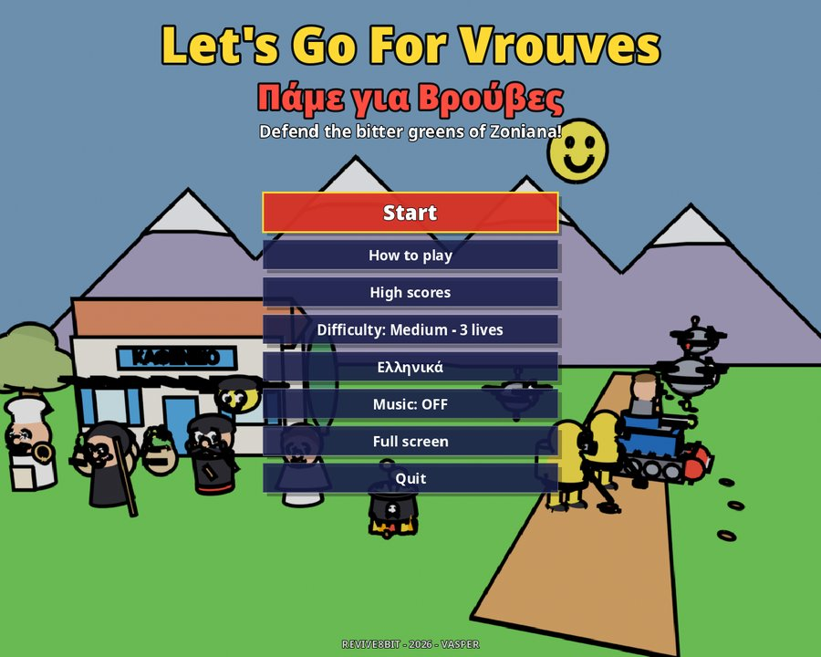
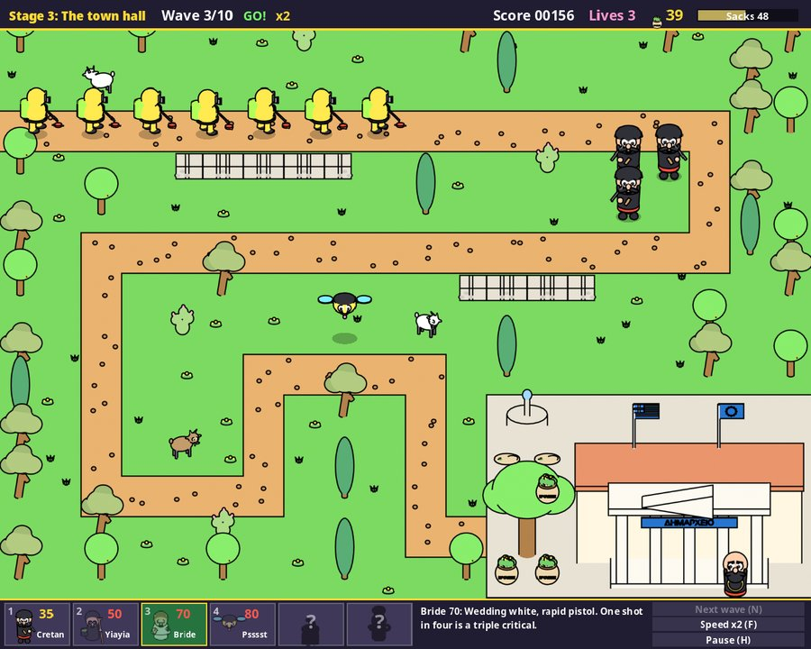

<h1 align="center">Let's Go For Vrouves</h1>

<b>Player's manual</b> · <a href="Manual-GR.md">Ελληνικά</a>

## Contents

1. [The story](#the-story)
2. [Installing the game](#installing-the-game)
3. [The title screen](#the-title-screen)
4. [How a stage is played](#how-a-stage-is-played)
5. [The screen](#the-screen)
6. [Controls](#controls)
7. [The defenders](#the-defenders)
8. [Neighbours](#neighbours)
9. [The invaders](#the-invaders)
10. [Vrouves, score and lives](#vrouves-score-and-lives)
11. [The seven stages](#the-seven-stages)
12. [Tips](#tips)
13. [Questions and problems](#questions-and-problems)

---

## The story

Armed with EU Directive 8647/2026, the corporate Goliaths at **Frankenstein & Moreau Co.**
are sending bio-drones, compliance guards and heavy machinery to destroy the *vrouves*: the
wild, "copyrighted" bitter mountain greens of Crete.

In the village of **Zoniana** the villagers will not give them up. Put the defenders on the
map and protect the kafenio, the church, the town hall and the rest of the village, along
with their precious sacks of greens.

Luckily the corporate drone **Psssst** has defected, and fights alongside the heavily
fortified villagers.

---

## Installing the game

### Requirements

| | |
| --- | --- |
| Windows | Windows 10 or 11, 64-bit |
| Linux | 64-bit (x86_64), any recent distribution with a desktop |
| macOS | macOS 11 Big Sur or newer, Intel or Apple silicon |
| Graphics | any card with OpenGL 3.3 |
| Screen | 1120 × 896 window, or full screen at any size |

### With the setup program

There is one setup file for each system, with the whole game inside it:

| System | File |
| --- | --- |
| Windows | `VrouvesSetup-windows-x64.exe` |
| Linux | `VrouvesSetup-linux-x64` |
| macOS (Apple M1 or newer) | `VrouvesSetup-macos-arm64.zip` |
| macOS (Intel) | `VrouvesSetup-macos-x64.zip` |

1. Start the setup.
   * **Windows:** double click the `.exe`. If Windows SmartScreen warns about an unknown
     app, choose *More info → Run anyway*.
   * **Linux:** make the file executable (in the file manager, *Properties → Permissions*,
     or `chmod +x VrouvesSetup-linux-x64`), then double click it.
   * **macOS:** unzip the file, then **right click** *Let's Go For Vrouves Setup* and choose
     **Open**. The first time, macOS warns that the app comes from an unidentified
     developer; *Open* starts it anyway.
2. The setup speaks English or Greek, following your system. The button at the top right
   switches language.
3. Choose the folder and whether you want a desktop shortcut and a menu entry, then press
   **Install**.
4. At the end, leave *Play now* ticked to start the game at once.

The game is installed **only for you**, so no administrator password is needed:

| System | Folder | Shortcuts |
| --- | --- | --- |
| Windows | `%LOCALAPPDATA%\Programs\LetsGoForVrouves` | Start menu, desktop |
| Linux | `~/.local/share/LetsGoForVrouves` | applications menu, desktop |
| macOS | `~/Applications/Let's Go For Vrouves.app` | desktop |

### Uninstalling

* **Windows:** *Settings → Apps → Installed apps → Let's Go For Vrouves → Uninstall*.
* **Any system:** run the setup again (or `uninstall` in the game's folder) and press
  **Uninstall it**.

The uninstaller removes only what the setup put on the computer. Your high scores and
settings stay (see [Questions and problems](#questions-and-problems)).

If the game is already installed, the setup says so; **Next** installs it again over the
old one, for example to update it.

### Without the setup

The game itself is a single file (`LetsGoForVrouves.exe` on Windows,
`LetsGoForVrouves.x86_64` on Linux, `LetsGoForVrouves.app` on macOS) and runs from any
folder, even a USB stick.

### For administrators

The setup also runs without questions:

| Option | Meaning |
| --- | --- |
| `--quiet` | install (or uninstall) at once, with no windows |
| `--dir FOLDER` | install into FOLDER |
| `--no-shortcuts` | no desktop or menu shortcuts |
| `--uninstall` | remove the game |

For example: `VrouvesSetup-windows-x64.exe --quiet --no-shortcuts`.

---

## The title screen

| Menu | |
| --- | --- |
| **Start** | a new game, from stage 1 |
| **How to play** | the story, the defenders, the invaders and the controls, page by page |
| **High scores** | the eight best scores |
| **Difficulty** | Easy, Medium, Hard or Hardest (see [lives](#lives-and-difficulty)) |
| **Ελληνικά / English** | the language |
| **Music** | music on or off (the sound effects stay) |
| **Full screen** | full screen or window |
| **Quit** | back to the desktop |

Use the mouse, or **↑ ↓** (or **Q A**) and **ENTER**. **SPACE** starts a game at once,
**D** changes the difficulty, **L** the language and **M** the music. In the *How to play*
pages, **→ ←** (or a click) turn the page and **ESC** goes back to the menu.

The game remembers your language, difficulty, music and screen choices.

---

## How a stage is played

The invaders come in from the edge of the map and head for the village building on the
right. The walkers (guards and tanks) follow the dirt road. The drones fly straight over
everything, walls and trees included.

1. At the start of a stage you have **120 vrouves** (the money of the game) and **45
   seconds** before the first wave.
2. Put defenders on the grass next to the road. Each one costs vrouves.
3. When you are ready, press **N** (or *Next wave*) or wait for the countdown.
4. Each defender shoots by itself at the invader that is **furthest along its way** and
   within its reach.
5. Every invader you stop gives you vrouves. Every wave you beat gives you a bonus. Spend
   them on more defenders, and press **N** for the next wave, or wait 15 seconds.
6. An invader that reaches the building takes some of the **sacks**. The bar on the top
   right starts at 100. When it falls to 0, the stage is lost.
7. Beat all **10 waves** and the stage is won. Wave 10 always brings the tanks!

Every stage starts again from scratch: 120 vrouves, full sacks and an empty map.

---

## The screen

**The top bar** shows, from left to right:

* the stage name;
* the wave (for example *Wave 3/10*);
* *Next in 12* while counting down to the next wave, or *GO!* while a wave is on;
* the game speed (*x2*, *x3*) when it is not normal;
* your **Score**;
* your **Lives**;
* your **vrouves** (the green sack and the number);
* the **Sacks** bar of the village (red below 30).

**The map** is a grid of 20 × 14 squares. The square under the cursor blinks green if you
can build the chosen defender there (or if a defender already stands there), and red if
you cannot. A white circle shows how far the defender will reach.

**The bottom bar** has the six defender cards (number key, price, name). On a card you
cannot afford, the price is red; a defender that has not joined yet shows a **?**. The text next to the
cards describes the chosen defender, or the defender under the mouse and what it sells
for. A second line shows the [neighbour bonus](#neighbours) that a defender would get on
that square. On the right are the *Next wave*, *Speed* and *Pause* buttons.

---

## Controls

Everything can be done with the mouse alone, or with the keyboard alone.

| Mouse | Keyboard | Action |
| --- | --- | --- |
| point at a square | **← → ↑ ↓** or **O P Q A** | move the cursor |
| left click | **SPACE** or **ENTER** | build the chosen defender |
| right click | **S**, **DEL** or **BACKSPACE** | sell a defender (half its price back) |
| click a card | **1** – **6** | choose a defender |
| *Next wave* | **N** | call the next wave now |
| *Speed* | **F** | game speed ×1, ×2, ×3 |
| *Pause* | **H** | pause / continue |
| | **ESC** | pause; **ESC** again quits to the title |
| | **L** | English / Ελληνικά |
| | **M** | music on / off |
| | **F11** or **Alt+ENTER** | full screen / window |

When a stage ends, click or press **SPACE** to continue.

---

## The defenders

| | Defender | Price | Reach | Shoots every | Damage | Hits drones | Sells for |
| --- | --- | ---: | ---: | ---: | ---: | :---: | ---: |
|  | **1 Cretan** | 35 | 2.5 | 0.76 s | 6 | ✔ | 17 |
|  | **2 Yiayia** | 50 | 1.5 | 0.92 s | 14 | ✘ | 25 |
|  | **3 Bride** | 70 | 2.3 | 0.28 s | 4 (×3) | ✔ | 35 |
|  | **4 Psssst** | 80 | 3.0 | 0.44 s | 5 | ✔ | 40 |
|  | **5 Cauldron** | 110 | 1.8 | 1.32 s | 8 (area) | ✘ | 55 |
|  | **6 Baker** | 60 | 2.8 | 1.48 s | 16 (area) | ✔ | 30 |

*Reach* is in squares, from the middle of the defender's square.

**Cretan.** In midnight black, with a hunting rifle. Cheap, steady and good against both
drones and walkers. The backbone of every defence, and a good neighbour for the Bride.

**Yiayia.** Her staff of chastisement hits the leading walker hard, and her pot of bitter
leaves **slows down every walker around her** for 1.6 seconds. She cannot reach drones. Put
her right next to a bend of the road.

**Bride.** In wedding white, with a rapid pistol. One shot in four is a **critical: triple
damage**. Very strong next to a Cretan.

**Psssst.** The defected drone. Its laser **melts armour**: every hit takes one point of
armour off the target for good, so a guard is bare after 2 hits and a tank after 4. It has
the longest reach, and it is the **only defender that can hover over trees, cacti, goats,
cypresses, walls and graves**.

**Cauldron.** Unlicensed lipids and ascorbic acids. It throws a toxic cloud on **every
walker in reach**, for 8 damage that **ignores armour**, and slows them for 1.2 seconds. It
cannot reach drones. **Tanks dent it:** a tank passing on a square next to a Cauldron (left,
right, above or below) puts it out of action for 5 seconds.

**Baker.** Hurls *dakos* (barley rusks). Where a rusk lands it **splashes everything** within
one square, drones too, even if its target is already gone. Slow, but deadly against crowds.

### Where you can build

| Square | Who can go there |
| --- | --- |
| grass, the pitch | every defender |
| trees, cacti, goats, cypresses, walls, graves | **Psssst only** |
| the road, the building and its yard | nobody |

Each square holds one defender. You can sell a defender at any time, even in the middle
of a wave, and you get back about half of what it cost.

---

## Neighbours

Some defenders work better (or worse) when they stand **right next to** a certain other
defender: on the square to the left, right, above or below, not diagonally.

| Defender | next to a | Damage |
| --- | --- | --- |
| Bride | Cretan | **+50%** (4 → 6, critical 18) |
| Yiayia | Baker | **+20%** (14 → 17) |
| Psssst | Cretan | **−20%** (5 → 4) |
| Baker | Cretan | **−50%** (16 → 8) |

* Only the defender in the first column changes. A Cretan next to a Bride stays the same.
* Two partners do not count twice.
* **At most three bonuses** can be active at a time on the map. A defender that already has
  a bonus keeps it. When all three places are taken, the bottom bar says *(bonus places
  full)* in grey.
* **Penalties always apply.** Keep the Bakers and the Psssts away from the Cretans!

Before you build, the second line of the bottom bar shows what the chosen defender would
get on the square under the cursor: green for a bonus, red for a penalty.

---

## The invaders

| | Invader | Health | Armour | Speed | Takes from the sacks | Vrouves | Points |
| --- | --- | --- | ---: | --- | ---: | ---: | ---: |
|  | **Bio-drone** | 9 in wave 1, +3 each wave | 0 | fast | 4 | 3 | 4 |
|  | **Compliance guard** | 24 in wave 1, +8 each wave | 2 | slow | 8 | 4 | 8 |
|  | **Weed destroyer** | 69 in wave 1, +19 each wave | 4 | slowest | 20 | 10 | 20 |

**Bio-drone.** Fast and fragile. It **flies straight over the walls** on its own route, so
it is not on the road. Yiayia and the Cauldron cannot touch it.

**Compliance guard.** An armoured walker with a weed-whacker and herbicide.

**Weed destroyer.** A tracked tank with a bureaucrat on top and plenty of health. It
**dents the Cauldrons** next to the road.

**Armour** is taken off every hit, but a hit always does at least 1 damage. A Cretan (6)
does only 2 to a tank (armour 4), while a Cauldron does its full 8. Psssst's laser removes
armour for good.

The invaders get tougher with every wave (up to 255 health), and in stages 3 and 4 they are
tougher from the start.
At most 16 invaders can be on the map at once; the rest wait their turn.

---

## Vrouves, score and lives

### Vrouves

| | Vrouves |
| --- | ---: |
| start of every stage | 120 |
| a drone / guard / tank stopped | +3 / +4 / +10 |
| a wave beaten | +15 + 3 × the wave (18 after wave 1, 45 after wave 10) |
| a wave called early with **N** | + half the seconds left |
| a defender sold | + about half its price |

Vrouves do not carry over to the next stage.

### Score

| | Points |
| --- | ---: |
| a drone / guard / tank stopped | +4 / +8 / +20 |
| a wave called early with **N** | + the seconds left |
| a defender built | + its damage (6, 14, 4, 5, 8, 16); taken back if you sell it |
| a stage won | + all the vrouves you have left |

So calling the waves early and finishing a stage with vrouves in your pocket both pay.

### Lives and difficulty

| Difficulty | Lives |
| --- | ---: |
| Easy | 4 |
| Medium (the default) | 3 |
| Hard | 2 |
| Hardest | 0 |

The lives are for the whole game. When a stage is lost and you have a life left, you lose
it and play **the same stage again from the start**, with the score you had when the stage
began. With no lives left, the game is over.

### High scores

The eight best scores are kept. If yours is one of them, type your name (up to 3 letters)
and press **ENTER**. A game you quit with **ESC** still counts.

---

## The seven stages

| Stage | Protect | New defender |
| --- | --- | --- |
| 1 | the kafenio | Cretan and Psssst |
| 2 | the village church | Yiayia |
| 3 | the town hall | Bride |
| 4 | the bakery | Baker |
| 5 | the school | Cauldron |
| 6 | the village pitch | |
| 7 | the cemetery church | |

Save the cemetery church and the whole village celebrates with a feast in front of the
school. *Kali orexi!*

---

## Tips

* **Bends are gold.** A defender on the inside of a bend of the road keeps the walkers in
  reach for much longer.
* **Mind the drones.** They take their own straight line to the building. Keep a Cretan,
  Bride, Psssst or Baker near the end of their route.
* **Bride + Cretan** is the best pair in the game. Use your three bonus places on it, or on
  Yiayia + Baker.
* **Psssst first, then the rest.** Against guards and tanks, a Psssst strips their armour so
  that everyone else hits harder. Remember it can stand on trees and graves, which nobody
  else can use.
* **Yiayia and the Cauldron** slow the walkers down, so the others get more shots at them.
  Keep the Cauldrons one square away from the road, or tanks will dent them.
* **Call waves early** when your defence is strong: it pays vrouves and points.
* **Sell and rebuild.** Selling gives half back. Moving a Cretan away from a Baker is often
  worth it.
* Press **F** to speed up the easy waves, and **H** to stop and think.

---

## Questions and problems

**Where are my high scores and settings?**
In the game's data folder. Delete it to start afresh:

| System | Folder |
| --- | --- |
| Windows | `%APPDATA%\Godot\app_userdata\Let's Go For Vrouves` |
| Linux | `~/.local/share/godot/app_userdata/Let's Go For Vrouves` |
| macOS | `~/Library/Application Support/Godot/app_userdata/Let's Go For Vrouves` |

**macOS says the app "cannot be opened" or "is damaged".**
The game is not signed by Apple. Right click it, choose **Open**, then **Open** again. If
that does not help, open *System Settings → Privacy & Security* and press *Open Anyway*.

**Linux: nothing happens when I double click.**
Make the file executable (*Properties → Permissions*, or `chmod +x`).

**The game starts in a small window.**
Press **F11** (or **Alt+ENTER**) or choose *Full screen* on the title screen.

**I can't hear the music.**
Press **M**, or check *Music* on the title screen.

---

REVIVE8BIT · 2026 · VASPER 
After the Amstrad CPC game <i>Let's Go For Vrouves</i>. 
Fonts: Noto Sans (SIL Open Font License).

