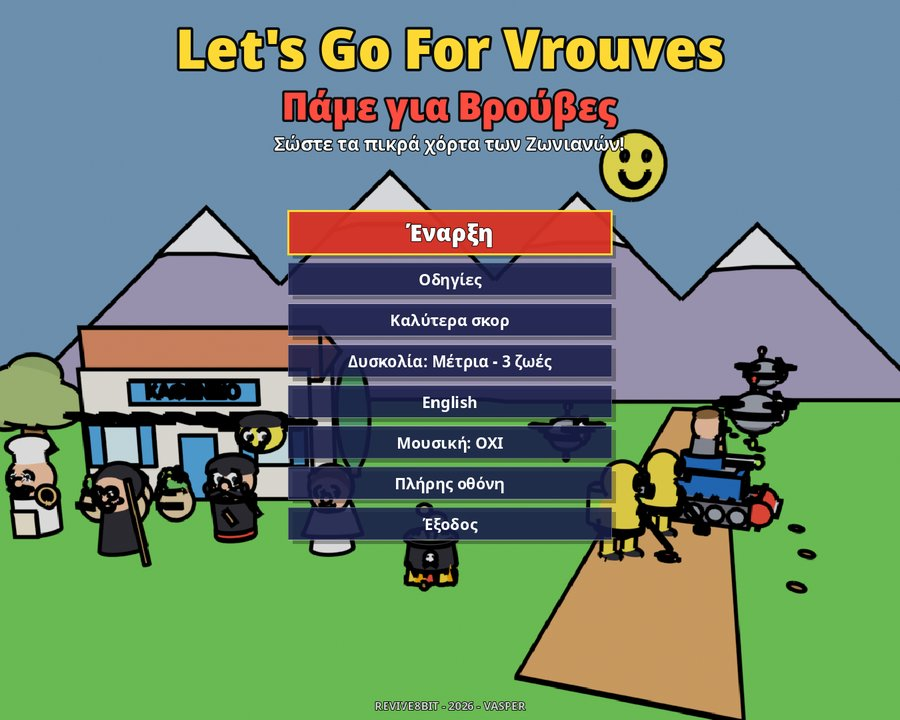
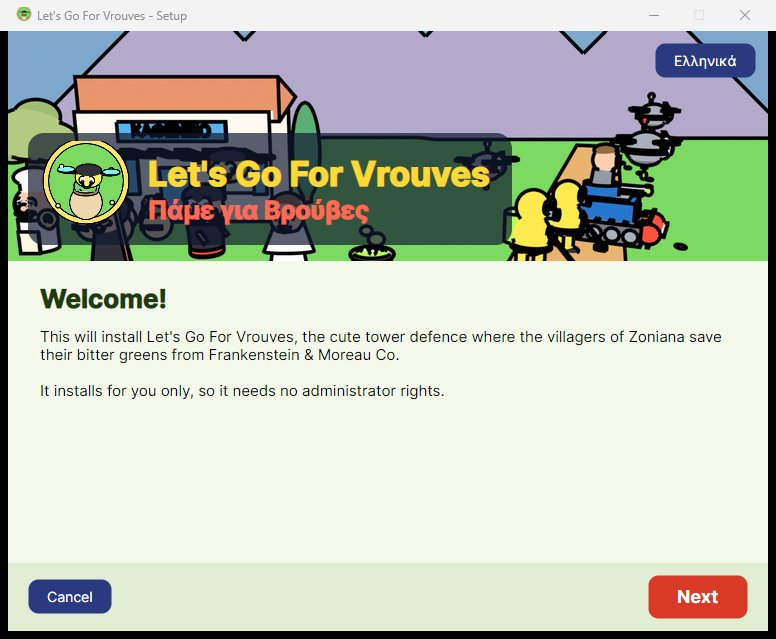
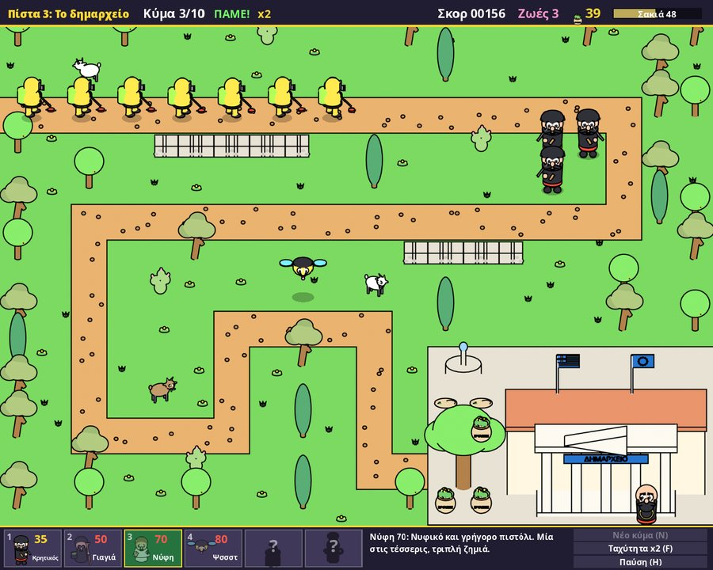

<h1 align="center">Πάμε για Βρούβες</h1>

<b>Εγχειρίδιο παίκτη</b> · <a href="Manual-EN.md">English</a>

## Περιεχόμενα

1. [Η ιστορία](#η-ιστορία)
2. [Εγκατάσταση](#εγκατάσταση)
3. [Η αρχική οθόνη](#η-αρχική-οθόνη)
4. [Πώς παίζεται μια πίστα](#πώς-παίζεται-μια-πίστα)
5. [Η οθόνη](#η-οθόνη)
6. [Χειρισμός](#χειρισμός)
7. [Οι υπερασπιστές](#οι-υπερασπιστές)
8. [Οι γείτονες](#οι-γείτονες)
9. [Οι εισβολείς](#οι-εισβολείς)
10. [Βρούβες, σκορ και ζωές](#βρούβες-σκορ-και-ζωές)
11. [Οι επτά πίστες](#οι-επτά-πίστες)
12. [Συμβουλές](#συμβουλές)
13. [Ερωτήσεις και προβλήματα](#ερωτήσεις-και-προβλήματα)

---

## Η ιστορία

Οπλισμένοι με την Οδηγία ΕΕ 8647/2026, οι κολοσσοί της **Frankenstein & Moreau Co.**
στέλνουν βιο-ντρον, φύλακες συμμόρφωσης και βαριά μηχανήματα για να ξεριζώσουν τις
*βρούβες*: τα άγρια, «κατοχυρωμένα» πικρά χόρτα των βουνών της Κρήτης.

Στα **Ζωνιανά** όμως οι χωριανοί δεν τις δίνουν. Στήσε τους υπερασπιστές στον χάρτη και
προστάτεψε το καφενείο, την εκκλησία, το δημαρχείο και όλο το χωριό, μαζί με τα πολύτιμα
σακιά με τα χόρτα.

Ευτυχώς το ντρον της εταιρείας **Ψσσστ** αυτομόλησε και πολεμά δίπλα στους οχυρωμένους
χωριανούς.

---

## Εγκατάσταση

### Τι χρειάζεται

| | |
| --- | --- |
| Windows | Windows 10 ή 11, 64-bit |
| Linux | 64-bit (x86_64), οποιαδήποτε πρόσφατη διανομή με γραφικό περιβάλλον |
| macOS | macOS 11 Big Sur ή νεότερο, Intel ή Apple silicon |
| Κάρτα γραφικών | οποιαδήποτε με OpenGL 3.3 |
| Οθόνη | παράθυρο 1120 × 896, ή πλήρης οθόνη σε οποιοδήποτε μέγεθος |

### Με το πρόγραμμα εγκατάστασης

Υπάρχει ένα αρχείο εγκατάστασης για κάθε σύστημα, με όλο το παιχνίδι μέσα:

| Σύστημα | Αρχείο |
| --- | --- |
| Windows | `VrouvesSetup-windows-x64.exe` |
| Linux | `VrouvesSetup-linux-x64` |
| macOS (Apple M1 ή νεότερο) | `VrouvesSetup-macos-arm64.zip` |
| macOS (Intel) | `VrouvesSetup-macos-x64.zip` |

1. Ξεκίνα την εγκατάσταση.
   * **Windows:** διπλό κλικ στο `.exe`. Αν το Windows SmartScreen προειδοποιήσει για
     άγνωστη εφαρμογή, διάλεξε *Περισσότερες πληροφορίες → Εκτέλεση οπωσδήποτε*.
   * **Linux:** κάνε το αρχείο εκτελέσιμο (στη διαχείριση αρχείων, *Ιδιότητες →
     Δικαιώματα*, ή `chmod +x VrouvesSetup-linux-x64`) και μετά διπλό κλικ.
   * **macOS:** αποσυμπίεσε το αρχείο, κάνε **δεξί κλικ** στο *Let's Go For Vrouves Setup*
     και διάλεξε **Άνοιγμα**. Την πρώτη φορά το macOS λέει ότι η εφαρμογή είναι από
     άγνωστο προγραμματιστή· το *Άνοιγμα* την ξεκινά παρ' όλα αυτά.
2. Η εγκατάσταση μιλά Ελληνικά ή Αγγλικά, ανάλογα με το σύστημά σου. Το κουμπί πάνω δεξιά
   αλλάζει γλώσσα.
3. Διάλεξε φάκελο και αν θέλεις συντόμευση στην επιφάνεια εργασίας και στο μενού, και πάτα
   **Εγκατάσταση**.
4. Στο τέλος, άφησε τσεκαρισμένο το *Παίξε τώρα* για να ξεκινήσει αμέσως το παιχνίδι.

Το παιχνίδι εγκαθίσταται **μόνο για σένα**, οπότε δεν χρειάζεται κωδικός διαχειριστή:

| Σύστημα | Φάκελος | Συντομεύσεις |
| --- | --- | --- |
| Windows | `%LOCALAPPDATA%\Programs\LetsGoForVrouves` | μενού Έναρξη, επιφάνεια εργασίας |
| Linux | `~/.local/share/LetsGoForVrouves` | μενού εφαρμογών, επιφάνεια εργασίας |
| macOS | `~/Applications/Let's Go For Vrouves.app` | επιφάνεια εργασίας |

### Απεγκατάσταση

* **Windows:** *Ρυθμίσεις → Εφαρμογές → Εγκατεστημένες εφαρμογές → Let's Go For Vrouves →
  Κατάργηση εγκατάστασης*.
* **Σε κάθε σύστημα:** ξανατρέξε την εγκατάσταση (ή το `uninstall` στον φάκελο του
  παιχνιδιού) και πάτα **Απεγκατάσταση**.

Η απεγκατάσταση αφαιρεί μόνο ό,τι έβαλε η εγκατάσταση στον υπολογιστή. Τα ρεκόρ και οι
ρυθμίσεις σου μένουν (δες [Ερωτήσεις και προβλήματα](#ερωτήσεις-και-προβλήματα)).

Αν το παιχνίδι είναι ήδη εγκατεστημένο, η εγκατάσταση το λέει· το **Επόμενο** το
εγκαθιστά ξανά από πάνω, για παράδειγμα για ενημέρωση.

### Χωρίς εγκατάσταση

Το ίδιο το παιχνίδι είναι ένα μόνο αρχείο (`LetsGoForVrouves.exe` στα Windows,
`LetsGoForVrouves.x86_64` στο Linux, `LetsGoForVrouves.app` στο macOS) και τρέχει από
οποιονδήποτε φάκελο, ακόμα και από USB stick.

### Για διαχειριστές

Η εγκατάσταση τρέχει και χωρίς ερωτήσεις:

| Επιλογή | Τι κάνει |
| --- | --- |
| `--quiet` | εγκατάσταση (ή απεγκατάσταση) αμέσως, χωρίς παράθυρα |
| `--dir ΦΑΚΕΛΟΣ` | εγκατάσταση στον ΦΑΚΕΛΟ |
| `--no-shortcuts` | χωρίς συντομεύσεις |
| `--uninstall` | απεγκατάσταση |

Για παράδειγμα: `VrouvesSetup-windows-x64.exe --quiet --no-shortcuts`.

---

## Η αρχική οθόνη

| Μενού | |
| --- | --- |
| **Έναρξη** | νέο παιχνίδι, από την πίστα 1 |
| **Οδηγίες** | η ιστορία, οι υπερασπιστές, οι εισβολείς και ο χειρισμός, σελίδα σελίδα |
| **Καλύτερα σκορ** | τα οκτώ καλύτερα σκορ |
| **Δυσκολία** | Εύκολη, Μέτρια, Δύσκολη ή Πολύ δύσκολη (δες [ζωές](#ζωές-και-δυσκολία)) |
| **English / Ελληνικά** | η γλώσσα |
| **Μουσική** | μουσική ναι ή όχι (τα ηχητικά εφέ μένουν) |
| **Πλήρης οθόνη** | πλήρης οθόνη ή παράθυρο |
| **Έξοδος** | πίσω στην επιφάνεια εργασίας |

Με το ποντίκι, ή με **↑ ↓** (ή **Q A**) και **ENTER**. Το **SPACE** ξεκινά αμέσως
παιχνίδι, το **D** αλλάζει τη δυσκολία, το **L** τη γλώσσα και το **M** τη μουσική. Στις
σελίδες των *Οδηγιών*, τα **→ ←** (ή ένα κλικ) γυρίζουν σελίδα και το **ESC** γυρνά στο
μενού.

Το παιχνίδι θυμάται τη γλώσσα, τη δυσκολία, τη μουσική και την πλήρη οθόνη.

---

## Πώς παίζεται μια πίστα

Οι εισβολείς μπαίνουν από την άκρη του χάρτη και πάνε για το κτίριο του χωριού, δεξιά. Οι
πεζοί (φύλακες και τανκς) ακολουθούν τον χωματόδρομο. Τα ντρον πετούν ίσια πάνω από όλα,
τοίχους και δέντρα.

1. Στην αρχή κάθε πίστας έχεις **120 βρούβες** (τα λεφτά του παιχνιδιού) και **45
   δευτερόλεπτα** μέχρι το πρώτο κύμα.
2. Βάλε υπερασπιστές στο γρασίδι δίπλα στον δρόμο. Ο καθένας κοστίζει βρούβες.
3. Όταν είσαι έτοιμος, πάτα **N** (ή *Νέο κύμα*) ή περίμενε την αντίστροφη μέτρηση.
4. Κάθε υπερασπιστής ρίχνει μόνος του στον εισβολέα που είναι **πιο μπροστά στον δρόμο
   του** και τον φτάνει.
5. Κάθε εισβολέας που σταματάς σού δίνει βρούβες, και κάθε κύμα που αποκρούεις δίνει
   μπόνους. Ξόδεψέ τες σε κι άλλους υπερασπιστές, και πάτα **N** για το επόμενο κύμα ή
   περίμενε 15 δευτερόλεπτα.
6. Όποιος εισβολέας φτάσει στο κτίριο παίρνει από τα **σακιά**. Η μπάρα πάνω δεξιά
   ξεκινά από 100. Όταν πέσει στο 0, η πίστα χάνεται.
7. Απόκρουσε και τα **10 κύματα** και η πίστα κερδήθηκε. Στο 10ο κύμα έρχονται πάντα τα
   τανκς!

Κάθε πίστα ξεκινά από την αρχή: 120 βρούβες, γεμάτα σακιά και άδειος χάρτης.

---

## Η οθόνη

**Η πάνω μπάρα** δείχνει, από αριστερά προς τα δεξιά:

* το όνομα της πίστας·
* το κύμα (για παράδειγμα *Κύμα 3/10*)·
* *Επόμενο σε 12* όσο μετράει για το επόμενο κύμα, ή *ΠΑΜΕ!* όσο κρατάει ένα κύμα·
* την ταχύτητα (*x2*, *x3*) όταν δεν είναι κανονική·
* το **Σκορ**·
* τις **Ζωές**·
* τις **βρούβες** σου (το πράσινο σακί και ο αριθμός)·
* τη μπάρα με τα **Σακιά** του χωριού (κόκκινη κάτω από 30).

**Ο χάρτης** είναι ένα πλέγμα 20 × 14 τετραγώνων. Το τετράγωνο κάτω από τον κέρσορα
αναβοσβήνει πράσινο αν μπορείς να χτίσεις εκεί τον υπερασπιστή που διάλεξες (ή αν στέκεται
ήδη υπερασπιστής εκεί), και κόκκινο αν δεν μπορείς. Ένας άσπρος κύκλος δείχνει πόσο μακριά
θα φτάνει.

**Η κάτω μπάρα** έχει τις έξι κάρτες των υπερασπιστών (πλήκτρο, τιμή, όνομα). Όταν δεν
φτάνουν οι βρούβες, η τιμή είναι κόκκινη· ένας υπερασπιστής που δεν ήρθε ακόμα δείχνει
**?**. Το κείμενο δίπλα στις κάρτες περιγράφει τον υπερασπιστή που διάλεξες, ή αυτόν κάτω
από τον κέρσορα και πόσο πουλιέται. Μια δεύτερη γραμμή δείχνει το
[μπόνους γειτονιάς](#οι-γείτονες) που θα έπαιρνε ένας υπερασπιστής σε εκείνο το
τετράγωνο. Δεξιά είναι τα κουμπιά *Νέο κύμα*, *Ταχύτητα* και *Παύση*.

---

## Χειρισμός

Όλα γίνονται είτε μόνο με το ποντίκι είτε μόνο με το πληκτρολόγιο.

| Ποντίκι | Πληκτρολόγιο | Ενέργεια |
| --- | --- | --- |
| δείξε ένα τετράγωνο | **← → ↑ ↓** ή **O P Q A** | κίνηση του κέρσορα |
| αριστερό κλικ | **SPACE** ή **ENTER** | χτίσιμο του υπερασπιστή |
| δεξί κλικ | **S**, **DEL** ή **BACKSPACE** | πούλημα (παίρνεις πίσω τη μισή τιμή) |
| κλικ σε κάρτα | **1** – **6** | επιλογή υπερασπιστή |
| *Νέο κύμα* | **N** | το επόμενο κύμα τώρα |
| *Ταχύτητα* | **F** | ταχύτητα ×1, ×2, ×3 |
| *Παύση* | **H** | παύση / συνέχεια |
| | **ESC** | παύση· ξανά **ESC** για έξοδο στην αρχική οθόνη |
| | **L** | Ελληνικά / English |
| | **M** | μουσική ναι / όχι |
| | **F11** ή **Alt+ENTER** | πλήρης οθόνη / παράθυρο |

Όταν τελειώσει μια πίστα, κάνε κλικ ή πάτα **SPACE** για να συνεχίσεις.

---

## Οι υπερασπιστές

| | Υπερασπιστής | Τιμή | Βεληνεκές | Ρίχνει κάθε | Ζημιά | Χτυπά ντρον | Πουλιέται |
| --- | --- | ---: | ---: | ---: | ---: | :---: | ---: |
|  | **1 Κρητικός** | 35 | 2,5 | 0,76 δλ. | 6 | ✔ | 17 |
|  | **2 Γιαγιά** | 50 | 1,5 | 0,92 δλ. | 14 | ✘ | 25 |
|  | **3 Νύφη** | 70 | 2,3 | 0,28 δλ. | 4 (×3) | ✔ | 35 |
|  | **4 Ψσσστ** | 80 | 3,0 | 0,44 δλ. | 5 | ✔ | 40 |
|  | **5 Καζάνι** | 110 | 1,8 | 1,32 δλ. | 8 (περιοχή) | ✘ | 55 |
|  | **6 Φούρναρης** | 60 | 2,8 | 1,48 δλ. | 16 (περιοχή) | ✔ | 30 |

Το *βεληνεκές* είναι σε τετράγωνα, από τη μέση του τετραγώνου του υπερασπιστή.

**Κρητικός.** Μαυροφόρος, με κυνηγετικό τουφέκι. Φτηνός, σταθερός, καλός και για ντρον
και για πεζούς. Η ραχοκοκαλιά κάθε άμυνας, και καλός γείτονας για τη Νύφη.

**Γιαγιά.** Η μαγκούρα της χτυπά δυνατά τον πρώτο πεζό, και τα πικρά της χόρτα
**φρενάρουν όλους τους πεζούς γύρω της** για 1,6 δευτερόλεπτα. Δεν φτάνει τα ντρον. Βάλ' τη
ακριβώς δίπλα σε μια στροφή του δρόμου.

**Νύφη.** Στα λευκά, με γρήγορο πιστόλι. Μία στις τέσσερις βολές είναι **τριπλή ζημιά**.
Πολύ δυνατή δίπλα σε Κρητικό.

**Ψσσστ.** Το αυτόμολο ντρον. Το λέιζερ του **λιώνει τους θώρακες**: κάθε χτύπημα αφαιρεί
για πάντα έναν πόντο θωράκισης, οπότε ένας φύλακας μένει ξεθώρακος σε 2 χτυπήματα και ένα
τανκ σε 4. Έχει το μεγαλύτερο βεληνεκές και είναι ο **μόνος που πετά πάνω από δέντρα,
κάκτους, κατσίκια, κυπαρίσσια, τοίχους και τάφους**.

**Καζάνι.** Αδειοδότητα λιπίδια και ασκορβικά. Ρίχνει τοξικό σύννεφο σε **όλους τους πεζούς
που φτάνει**, με 8 ζημιά που **αγνοεί τους θώρακες**, και τους φρενάρει για 1,2
δευτερόλεπτα. Δεν φτάνει τα ντρον. **Τα τανκς το στραβώνουν:** ένα τανκ που περνά από
τετράγωνο δίπλα σε καζάνι (αριστερά, δεξιά, πάνω ή κάτω) το βγάζει εκτός μάχης για 5
δευτερόλεπτα.

**Φούρναρης.** Πετάει ντάκους (κριθαροκούλουρα). Όπου πέσει ο ντάκος **πιτσιλάει τα
πάντα** σε απόσταση ενός τετραγώνου, και τα ντρον, ακόμα κι αν ο στόχος του έχει ήδη
φύγει. Αργός, αλλά φονικός στο μπουλούκι.

### Πού χτίζεις

| Τετράγωνο | Ποιος μπαίνει |
| --- | --- |
| γρασίδι, γήπεδο | όλοι οι υπερασπιστές |
| δέντρα, κάκτοι, κατσίκια, κυπαρίσσια, τοίχοι, τάφοι | **μόνο το Ψσσστ** |
| ο δρόμος, το κτίριο και η αυλή του | κανείς |

Σε κάθε τετράγωνο χωράει ένας υπερασπιστής. Μπορείς να πουλήσεις έναν υπερασπιστή
οποιαδήποτε στιγμή, ακόμα και στη μέση ενός κύματος, και παίρνεις πίσω περίπου τα μισά από
όσα κόστισε.

---

## Οι γείτονες

Μερικοί υπερασπιστές τα πάνε καλύτερα (ή χειρότερα) όταν στέκονται **ακριβώς δίπλα** σε
έναν συγκεκριμένο άλλο: στο τετράγωνο αριστερά, δεξιά, πάνω ή κάτω, όχι διαγώνια.

| Υπερασπιστής | δίπλα σε | Ζημιά |
| --- | --- | --- |
| Νύφη | Κρητικό | **+50%** (4 → 6, τριπλή 18) |
| Γιαγιά | Φούρναρη | **+20%** (14 → 17) |
| Ψσσστ | Κρητικό | **−20%** (5 → 4) |
| Φούρναρης | Κρητικό | **−50%** (16 → 8) |

* Αλλάζει μόνο ο υπερασπιστής της πρώτης στήλης. Ένας Κρητικός δίπλα σε Νύφη μένει ίδιος.
* Δύο γείτονες του ίδιου είδους δεν μετράνε διπλά.
* **Το πολύ τρία μπόνους** μπορούν να ισχύουν μαζί σε όλο τον χάρτη. Όποιος έχει ήδη μπόνους
  το κρατά. Όταν πιαστούν και οι τρεις θέσεις, η κάτω μπάρα γράφει με γκρι
  *(γεμάτες οι θέσεις μπόνους)*.
* **Οι ποινές ισχύουν πάντα.** Κράτα τους Φούρναρηδες και τα Ψσσστ μακριά από τους
  Κρητικούς!

Πριν χτίσεις, η δεύτερη γραμμή της κάτω μπάρας δείχνει τι θα έπαιρνε ο υπερασπιστής στο
τετράγωνο κάτω από τον κέρσορα: πράσινο για μπόνους, κόκκινο για ποινή.

---

## Οι εισβολείς

| | Εισβολέας | Ζωή | Θώρακας | Ταχύτητα | Παίρνει από τα σακιά | Βρούβες | Πόντοι |
| --- | --- | --- | ---: | --- | ---: | ---: | ---: |
|  | **Βιο-ντρον** | 9 στο 1ο κύμα, +3 σε κάθε κύμα | 0 | γρήγορο | 4 | 3 | 4 |
|  | **Φύλακας συμμόρφωσης** | 24 στο 1ο κύμα, +8 σε κάθε κύμα | 2 | αργός | 8 | 4 | 8 |
|  | **Καταστροφέας χόρτων** | 69 στο 1ο κύμα, +19 σε κάθε κύμα | 4 | ο πιο αργός | 20 | 10 | 20 |

**Βιο-ντρον.** Γρήγορο και εύθραυστο. **Πετά ίσια πάνω από τους τοίχους**, από τη δική του
διαδρομή, όχι από τον δρόμο. Η Γιαγιά και το Καζάνι δεν το φτάνουν.

**Φύλακας συμμόρφωσης.** Θωρακισμένος πεζός με χορτοκοπτικό και ζιζανιοκτόνο.

**Καταστροφέας χόρτων.** Ερπυστριοφόρο με έναν γραφειοκράτη από πάνω και πολλή ζωή.
**Στραβώνει τα καζάνια** δίπλα στον δρόμο.

Ο **θώρακας** αφαιρείται από κάθε χτύπημα, αλλά ένα χτύπημα κάνει πάντα τουλάχιστον 1
ζημιά. Ένας Κρητικός (6) κάνει μόνο 2 σε ένα τανκ (θώρακας 4), ενώ το Καζάνι κάνει όλα του
τα 8. Το λέιζερ του Ψσσστ αφαιρεί θωράκιση για πάντα.

Οι εισβολείς δυναμώνουν σε κάθε κύμα (ως 255 ζωή), και στις πίστες 3 και 4 είναι πιο
δυνατοί από την αρχή. Στον χάρτη χωράνε ως 16 εισβολείς μαζί· οι υπόλοιποι περιμένουν τη
σειρά τους.

---

## Βρούβες, σκορ και ζωές

### Βρούβες

| | Βρούβες |
| --- | ---: |
| στην αρχή κάθε πίστας | 120 |
| ντρον / φύλακας / τανκ που σταματάς | +3 / +4 / +10 |
| κύμα που αποκρούεις | +15 + 3 × το κύμα (18 μετά το 1ο, 45 μετά το 10ο) |
| κύμα που καλείς νωρίς με **N** | + τα μισά δευτερόλεπτα που έμεναν |
| υπερασπιστής που πουλάς | + περίπου τη μισή του τιμή |

Οι βρούβες δεν περνάνε στην επόμενη πίστα.

### Σκορ

| | Πόντοι |
| --- | ---: |
| ντρον / φύλακας / τανκ που σταματάς | +4 / +8 / +20 |
| κύμα που καλείς νωρίς με **N** | + τα δευτερόλεπτα που έμεναν |
| υπερασπιστής που χτίζεις | + η ζημιά του (6, 14, 4, 5, 8, 16)· φεύγουν αν τον πουλήσεις |
| πίστα που κερδίζεις | + όσες βρούβες σού έμειναν |

Άρα συμφέρει και να καλείς τα κύματα νωρίς και να τελειώνεις την πίστα με βρούβες στην
τσέπη.

### Ζωές και δυσκολία

| Δυσκολία | Ζωές |
| --- | ---: |
| Εύκολη | 4 |
| Μέτρια (η αρχική) | 3 |
| Δύσκολη | 2 |
| Πολύ δύσκολη | 0 |

Οι ζωές είναι για όλο το παιχνίδι. Όταν χάνεις μια πίστα και σου έχει μείνει ζωή, τη χάνεις
και παίζεις **την ίδια πίστα από την αρχή**, με το σκορ που είχες όταν ξεκίνησε. Χωρίς ζωές,
το παιχνίδι τελειώνει.

### Καλύτερα σκορ

Κρατιούνται τα οκτώ καλύτερα σκορ. Αν το δικό σου είναι ανάμεσά τους, γράψε το όνομά σου
(ως 3 γράμματα) και πάτα **ENTER**. Μετράει και ένα παιχνίδι που σταμάτησες με **ESC**.

---

## Οι επτά πίστες

| Πίστα | Προστατεύεις | Νέος υπερασπιστής |
| --- | --- | --- |
| 1 | το καφενείο | Κρητικός και Ψσσστ |
| 2 | την εκκλησία του χωριού | Γιαγιά |
| 3 | το δημαρχείο | Νύφη |
| 4 | τον φούρνο | Φούρναρης |
| 5 | το σχολείο | Καζάνι |
| 6 | το γήπεδο του χωριού | |
| 7 | την εκκλησία του νεκροταφείου | |

Σώσε την εκκλησία του νεκροταφείου και όλο το χωριό γιορτάζει με τραπέζι μπροστά στο
σχολείο. *Καλή όρεξη!*

---

## Συμβουλές

* **Οι στροφές είναι χρυσάφι.** Ένας υπερασπιστής στην εσωτερική πλευρά μιας στροφής
  κρατά τους πεζούς στο βεληνεκές του πολύ περισσότερο.
* **Πρόσεχε τα ντρον.** Παίρνουν τη δική τους ευθεία ως το κτίριο. Έχε έναν Κρητικό, μια
  Νύφη, ένα Ψσσστ ή έναν Φούρναρη κοντά στο τέλος της διαδρομής τους.
* **Νύφη + Κρητικός** είναι το καλύτερο ζευγάρι του παιχνιδιού. Δώσε εκεί τις τρεις θέσεις
  μπόνους, ή σε Γιαγιά + Φούρναρη.
* **Πρώτα το Ψσσστ, μετά οι άλλοι.** Σε φύλακες και τανκς, το Ψσσστ τους βγάζει τον θώρακα
  και όλοι οι άλλοι χτυπούν πιο δυνατά. Θυμήσου ότι στέκεται και σε δέντρα και τάφους, που
  κανείς άλλος δεν μπορεί να πιάσει.
* **Η Γιαγιά και το Καζάνι** φρενάρουν τους πεζούς, οπότε οι άλλοι τους ρίχνουν
  περισσότερες βολές. Κράτα τα καζάνια ένα τετράγωνο μακριά από τον δρόμο, αλλιώς τα
  στραβώνουν τα τανκς.
* **Κάλεσε τα κύματα νωρίς** όταν η άμυνά σου είναι γερή: πληρώνει βρούβες και πόντους.
* **Πούλα και ξαναχτίσε.** Το πούλημα δίνει πίσω τα μισά. Συχνά αξίζει να απομακρύνεις έναν
  Κρητικό από έναν Φούρναρη.
* Πάτα **F** για να περάσουν γρήγορα τα εύκολα κύματα, και **H** για να σταματήσεις και να
  σκεφτείς.

---

## Ερωτήσεις και προβλήματα

**Πού είναι τα ρεκόρ και οι ρυθμίσεις μου;**
Στον φάκελο δεδομένων του παιχνιδιού. Σβήσε τον για να ξεκινήσεις από την αρχή:

| Σύστημα | Φάκελος |
| --- | --- |
| Windows | `%APPDATA%\Godot\app_userdata\Let's Go For Vrouves` |
| Linux | `~/.local/share/godot/app_userdata/Let's Go For Vrouves` |
| macOS | `~/Library/Application Support/Godot/app_userdata/Let's Go For Vrouves` |

**Το macOS λέει ότι η εφαρμογή «δεν μπορεί να ανοίξει» ή «είναι κατεστραμμένη».**
Το παιχνίδι δεν έχει υπογραφή της Apple. Κάνε δεξί κλικ, διάλεξε **Άνοιγμα** και ξανά
**Άνοιγμα**. Αν δεν βοηθήσει, άνοιξε *Ρυθμίσεις συστήματος → Απόρρητο και ασφάλεια* και
πάτα *Άνοιγμα οπωσδήποτε*.

**Linux: δεν γίνεται τίποτα με το διπλό κλικ.**
Κάνε το αρχείο εκτελέσιμο (*Ιδιότητες → Δικαιώματα*, ή `chmod +x`).

**Το παιχνίδι ανοίγει σε μικρό παράθυρο.**
Πάτα **F11** (ή **Alt+ENTER**) ή διάλεξε *Πλήρης οθόνη* στην αρχική οθόνη.

**Δεν ακούω μουσική.**
Πάτα **M**, ή δες τη *Μουσική* στην αρχική οθόνη.

---

REVIVE8BIT · 2026 · VASPER 
Από το παιχνίδι <i>Let's Go For Vrouves</i> του Amstrad CPC. 
Γραμματοσειρές: Noto Sans (SIL Open Font License).

